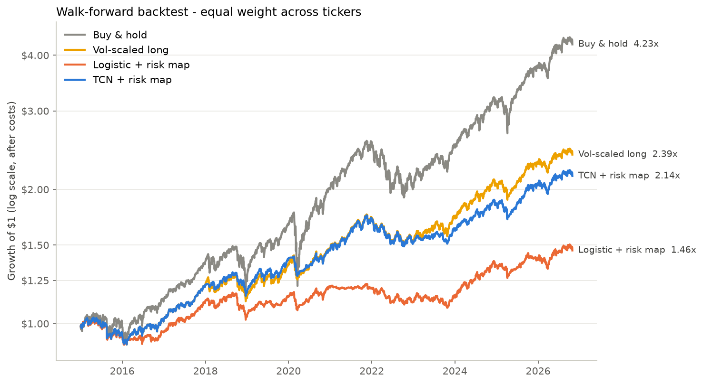
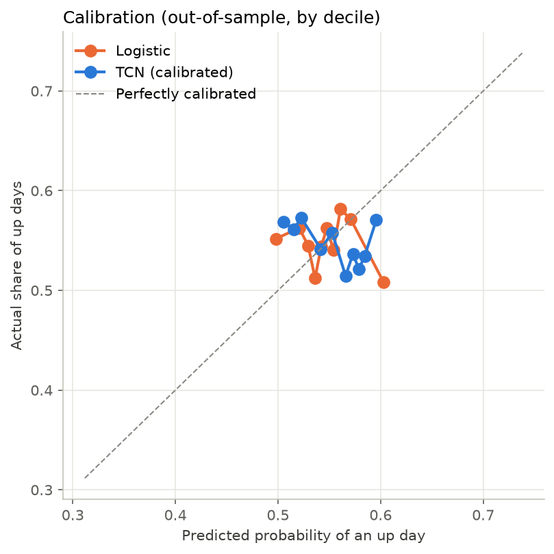

# Backtest report (PLACEBO - should show no edge)

- **run_utc:** 2026-11-02 12:12
- **commit:** e9f32fa
- **placebo:** True
- **device:** cpu
- **test_period:** 2015-01-02 -> 2026-10-29
- **samples:** 17827

## Strategy performance (out-of-sample, after costs)

| | CAGR | Volatility | Sharpe | Max drawdown | Avg exposure | Turnover/yr |
|---|---|---|---|---|---|---|
| Buy & hold | 12.7% | 16.1% | 0.83 | -31.6% | 1.00 | 0.1 |
| Vol-scaled long | 7.5% | 9.1% | 0.84 | -14.9% | 0.76 | 5.8 |
| Logistic + risk map | 3.2% | 7.1% | 0.48 | -13.1% | 0.55 | 32.9 |
| TCN + risk map | 6.5% | 8.5% | 0.79 | -14.9% | 0.70 | 6.7 |

## Prediction quality

| | AUC | AUC (avg per period) | Accuracy | Brier | Log loss |
|---|---|---|---|---|---|
| Always 'up' (base rate) | 0.5000 | 0.5000 | 0.5480 | 0.2477 | 0.6885 |
| Logistic | 0.4988 | 0.5057 | 0.5442 | 0.2489 | 0.6911 |
| TCN (calibrated) | 0.4904 | 0.5119 | 0.5465 | 0.2492 | 0.6915 |

## Sharpe by year

| | Buy & hold | Vol-scaled long | Logistic + risk map | TCN + risk map |
|---|---|---|---|---|
| 2015 | -0.04 | -0.58 | -0.71 | -0.58 |
| 2016 | 1.13 | 0.93 | 0.41 | 0.93 |
| 2017 | 2.80 | 2.72 | 2.67 | 2.72 |
| 2018 | -0.38 | -0.56 | -0.83 | -0.35 |
| 2019 | 2.42 | 2.08 | 2.11 | 2.08 |
| 2020 | 0.72 | 0.77 | 0.61 | 0.53 |
| 2021 | 2.10 | 1.88 | -0.01 | 1.87 |
| 2022 | -0.96 | -1.18 | -1.09 | -1.18 |
| 2023 | 1.81 | 1.44 | 0.50 | 1.11 |
| 2024 | 1.87 | 1.83 | 1.88 | 1.66 |
| 2025 | 1.18 | 1.24 | 0.49 | 1.15 |
| 2026 | 1.10 | 0.61 | 0.66 | 0.61 |

## Significance

TCN vs vol-scaled long: mean Sharpe gap -0.05; share of bootstrap draws where TCN is NOT better: 81% -> **indistinguishable from luck**.





## Config

```json
{
  "tickers": [
    "SPY",
    "QQQ",
    "XIU.TO",
    "XEQT.TO"
  ],
  "start": "2005-01-01",
  "data_dir": "data",
  "results_dir": "results",
  "window": 64,
  "test_start_year": 2015,
  "retrain_freq": "Y",
  "train_years": 10,
  "min_train_years": 5,
  "val_frac": 0.2,
  "embargo_days": 1,
  "channels": 32,
  "levels": 5,
  "kernel_size": 3,
  "dropout": 0.2,
  "epochs": 40,
  "patience": 6,
  "batch_size": 256,
  "lr": 0.001,
  "weight_decay": 0.0001,
  "seed": 42,
  "target_vol": 0.1,
  "vol_span": 20,
  "signal_sd": 2.0,
  "min_signal_scale": 0.02,
  "tau": 0.25,
  "w_min": 0.0,
  "w_max": 1.0,
  "cost_bps": 5.0
}
```
