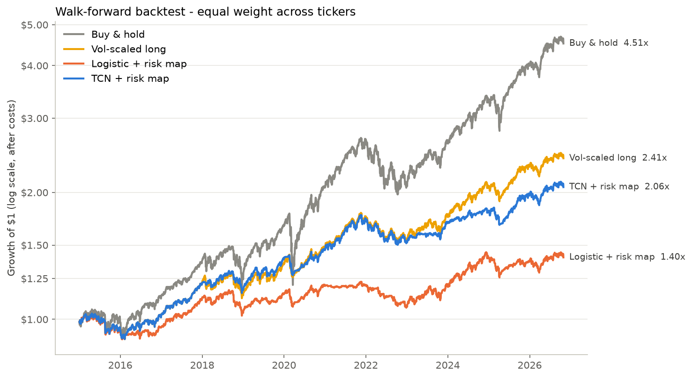
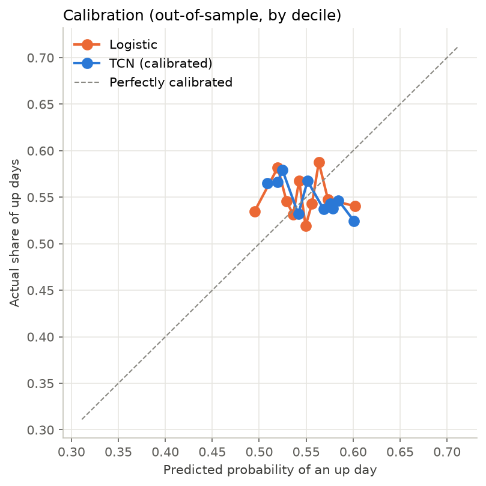

# Backtest report (PLACEBO - should show no edge)

- **run_utc:** 2026-11-02 11:25
- **commit:** 8fca49b
- **placebo:** True
- **device:** cpu
- **test_period:** 2015-01-02 -> 2026-10-29
- **samples:** 16128

## Strategy performance (out-of-sample, after costs)

| | CAGR | Volatility | Sharpe | Max drawdown | Avg exposure | Turnover/yr |
|---|---|---|---|---|---|---|
| Buy & hold | 13.4% | 16.9% | 0.83 | -32.3% | 1.00 | 0.1 |
| Vol-scaled long | 7.6% | 9.2% | 0.84 | -15.0% | 0.74 | 5.9 |
| Logistic + risk map | 2.9% | 7.4% | 0.42 | -13.2% | 0.55 | 30.2 |
| TCN + risk map | 6.2% | 8.3% | 0.76 | -15.0% | 0.65 | 6.6 |

## Prediction quality

| | AUC | Accuracy | Brier | Log loss |
|---|---|---|---|---|
| Always 'up' (base rate) | 0.5000 | 0.5499 | 0.2475 | 0.6882 |
| Logistic | 0.4997 | 0.5473 | 0.2485 | 0.6902 |
| TCN (calibrated) | 0.4862 | 0.5478 | 0.2491 | 0.6914 |

## Sharpe by year

| | Buy & hold | Vol-scaled long | Logistic + risk map | TCN + risk map |
|---|---|---|---|---|
| 2015 | -0.04 | -0.58 | -0.71 | -0.58 |
| 2016 | 1.13 | 0.93 | 0.41 | 0.93 |
| 2017 | 2.80 | 2.72 | 2.67 | 2.72 |
| 2018 | -0.38 | -0.56 | -0.83 | -0.35 |
| 2019 | 2.42 | 2.08 | 2.11 | 2.08 |
| 2020 | 0.78 | 0.84 | 0.56 | 0.52 |
| 2021 | 2.08 | 1.86 | 0.22 | 1.86 |
| 2022 | -0.97 | -1.22 | -1.73 | -1.22 |
| 2023 | 1.89 | 1.49 | 1.33 | 2.09 |
| 2024 | 1.77 | 1.68 | 1.66 | 1.00 |
| 2025 | 1.19 | 1.26 | -0.22 | 1.06 |
| 2026 | 1.08 | 0.60 | 0.36 | 0.60 |

## Significance

TCN vs vol-scaled long: mean Sharpe gap -0.08; share of bootstrap draws where TCN is NOT better: 86% -> **indistinguishable from luck**.





## Config

```json
{
  "tickers": [
    "SPY",
    "QQQ",
    "XIU.TO"
  ],
  "start": "2005-01-01",
  "data_dir": "data",
  "results_dir": "results",
  "window": 64,
  "test_start_year": 2015,
  "retrain_freq": "Y",
  "train_years": 10,
  "min_train_years": 5,
  "val_frac": 0.2,
  "embargo_days": 1,
  "channels": 32,
  "levels": 5,
  "kernel_size": 3,
  "dropout": 0.2,
  "epochs": 40,
  "patience": 6,
  "batch_size": 256,
  "lr": 0.001,
  "weight_decay": 0.0001,
  "seed": 42,
  "target_vol": 0.1,
  "vol_span": 20,
  "signal_sd": 2.0,
  "min_signal_scale": 0.02,
  "tau": 0.25,
  "w_min": 0.0,
  "w_max": 1.0,
  "cost_bps": 5.0
}
```
