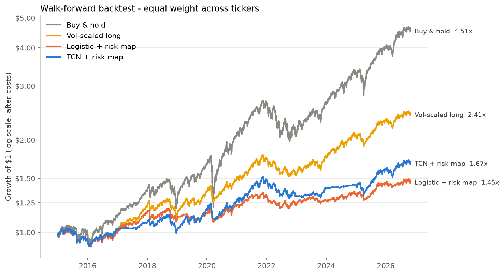
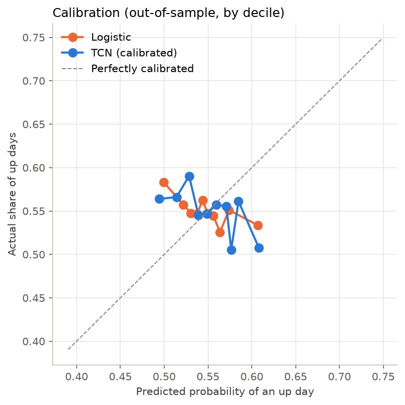

# Backtest report

- **run_utc:** 2026-11-02 11:25
- **commit:** 8fca49b
- **placebo:** False
- **device:** cpu
- **test_period:** 2015-01-02 -> 2026-10-29
- **samples:** 16128

## Strategy performance (out-of-sample, after costs)

| | CAGR | Volatility | Sharpe | Max drawdown | Avg exposure | Turnover/yr |
|---|---|---|---|---|---|---|
| Buy & hold | 13.4% | 16.9% | 0.83 | -32.3% | 1.00 | 0.1 |
| Vol-scaled long | 7.6% | 9.2% | 0.84 | -15.0% | 0.74 | 5.9 |
| Logistic + risk map | 3.1% | 7.2% | 0.46 | -11.3% | 0.52 | 32.1 |
| TCN + risk map | 4.4% | 8.2% | 0.56 | -14.8% | 0.59 | 6.4 |

## Prediction quality

| | AUC | Accuracy | Brier | Log loss |
|---|---|---|---|---|
| Always 'up' (base rate) | 0.5000 | 0.5499 | 0.2475 | 0.6882 |
| Logistic | 0.4873 | 0.5419 | 0.2492 | 0.6916 |
| TCN (calibrated) | 0.4811 | 0.5382 | 0.2497 | 0.6927 |

## Sharpe by year

| | Buy & hold | Vol-scaled long | Logistic + risk map | TCN + risk map |
|---|---|---|---|---|
| 2015 | -0.04 | -0.58 | -0.58 | -0.58 |
| 2016 | 1.13 | 0.93 | 0.66 | 0.93 |
| 2017 | 2.80 | 2.72 | 2.45 | 1.74 |
| 2018 | -0.38 | -0.56 | -0.54 | -0.53 |
| 2019 | 2.42 | 2.08 | 0.88 | 1.93 |
| 2020 | 0.78 | 0.84 | 0.64 | 0.56 |
| 2021 | 2.08 | 1.86 | 1.34 | 1.86 |
| 2022 | -0.97 | -1.22 | -0.89 | -1.20 |
| 2023 | 1.89 | 1.49 | 0.67 | 1.28 |
| 2024 | 1.77 | 1.68 | 0.68 | 1.01 |
| 2025 | 1.19 | 1.26 | 1.13 | 1.25 |
| 2026 | 1.08 | 0.60 | 0.14 | 0.60 |

## Significance

TCN vs vol-scaled long: mean Sharpe gap -0.28; share of bootstrap draws where TCN is NOT better: 100% -> **indistinguishable from luck**.





## Config

```json
{
  "tickers": [
    "SPY",
    "QQQ",
    "XIU.TO"
  ],
  "start": "2005-01-01",
  "data_dir": "data",
  "results_dir": "results",
  "window": 64,
  "test_start_year": 2015,
  "retrain_freq": "Y",
  "train_years": 10,
  "min_train_years": 5,
  "val_frac": 0.2,
  "embargo_days": 1,
  "channels": 32,
  "levels": 5,
  "kernel_size": 3,
  "dropout": 0.2,
  "epochs": 40,
  "patience": 6,
  "batch_size": 256,
  "lr": 0.001,
  "weight_decay": 0.0001,
  "seed": 42,
  "target_vol": 0.1,
  "vol_span": 20,
  "signal_sd": 2.0,
  "min_signal_scale": 0.02,
  "tau": 0.25,
  "w_min": 0.0,
  "w_max": 1.0,
  "cost_bps": 5.0
}
```
